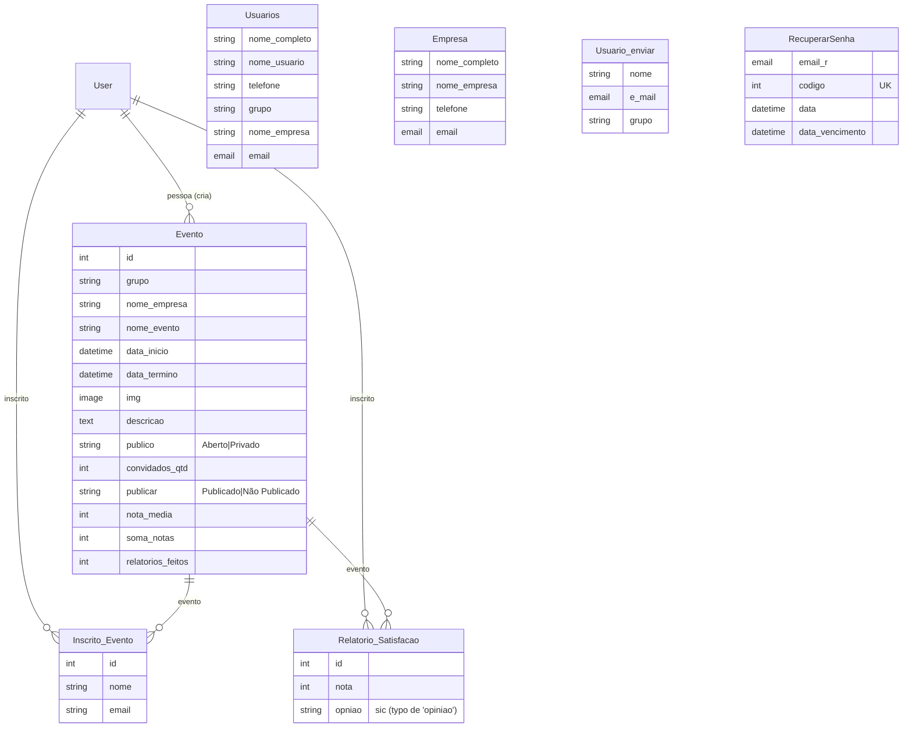

# SiteEventos — Guia do Repositório (CLAUDE.md)

> Analisado por Flash em 2026-09-21 — commit `3cbc2ab` (último commit real do projeto: 2022-11-30).
> Toda afirmação aqui saiu de um arquivo lido. Onde não há evidência, está marcado como "não identificado".

---

## 1. O que é

Plataforma web de **gestão de eventos**. Empresas/administradores cadastram eventos (públicos ou privados), usuários comuns se inscrevem, e após o evento recebem por e-mail um formulário de satisfação (nota + opinião). O sistema calcula nota média por evento, gera relatório em PDF de inscritos e permite disparo de e-mails em massa (individual, por grupo ou por planilha Excel importada). Há também fluxo de recuperação de senha por código enviado por e-mail.

Deduzido de: `apps/cadastrar_eventos/models.py`, `apps/enviar/views/enviar_email.py`, `apps/cadastrar_eventos/views/pdf.py`, `core/urls.py`. **Não há README de conteúdo** — `README.md` só contém o título.

---

## 2. Stack

| Camada | Tecnologia | Versão | Evidência |
|---|---|---|---|
| Linguagem | Python | não fixada (Django 4.1 exige 3.8+) | `Gestao_Novo/pacotes.txt` |
| Framework web | Django | 4.1 | `pacotes.txt:16`, `core/settings.py:4` |
| API REST | Django REST Framework | 3.14.0 | `pacotes.txt:20`, `settings.py:40` |
| Banco de dados | PostgreSQL (via psycopg2) | psycopg2 2.9.3 | `settings.py:88-96`, `pacotes.txt:33` |
| ORM | Django ORM | (Django 4.1) | `apps/*/models.py` |
| Auth | `django.contrib.auth` (User/Group nativos) | — | `usuarios/views/login.py`, `cadastros.py` |
| Templates | Django Templates + `widget_tweaks` | 1.4.12 | `settings.py:66-80`, `pacotes.txt:18` |
| Geração de PDF | xhtml2pdf / pisa + django-xhtml2pdf | 0.2.8 / 0.0.4 | `cadastrar_eventos/views/pdf.py:3` |
| Leitura de Excel | pyexcel | 0.7.0 | `enviar/views/enviar_email.py:8` |
| Imagens | Pillow | 9.2.0 | `models.py` (`ImageField`), `pacotes.txt:31` |
| Config por env | python-decouple | 3.6 | `settings.py:16` |
| Deploy (previsto) | Gunicorn + Whitenoise + django-heroku | 20.1.0 / 6.2.0 / 0.3.1 | `pacotes.txt` (django-heroku comentado em `settings.py:18,154`) |
| Testes | Django `TestCase` (arquivos vazios) | — | `apps/*/tests.py` (só boilerplate) |
| CI / Docker | **não identificado** | — | não há `.github/`, `Dockerfile`, `docker-compose.yml` |

> Divergência: `pacotes.txt` lista `gunicorn`, `whitenoise`, `django-heroku`, `dj-database-url` (deploy Heroku), mas o código de deploy está **comentado** (`settings.py:18,154`) e o banco está fixado em `localhost`. O deploy Heroku foi planejado e desativado. **Não é o padrão Vercel** habitual do Juan.

> Observação: `pacotes.txt` é o arquivo real de dependências (formato `pip freeze`), salvo em UTF-16. **Não existe `requirements.txt`** — ver seção 10.

---

## 3. Estrutura de pastas

```
SiteEventos/
├─ README.md                      # vazio (só título)
├─ assets/                        # imagens soltas na raiz (fora do Django)
└─ Gestao_Novo/                   # RAIZ real do projeto Django (BASE_DIR)
   ├─ manage.py                   # ponto de entrada Django
   ├─ pacotes.txt                 # dependências (pip freeze, UTF-16)
   ├─ main.js                     # script front avulso (verificar uso)
   ├─ .env                        # segredos locais (EMAIL_*) — NÃO commitar valores
   ├─ .vscode/launch.json         # config de debug do VS Code
   ├─ core/                       # projeto Django (config central)
   │  ├─ settings.py              # settings — contém SECRET_KEY e senha de BD hardcoded (!)
   │  ├─ urls.py                  # roteamento raiz + router DRF
   │  ├─ wsgi.py / asgi.py        # servidores
   ├─ apps/                       # apps de domínio (arquitetura feature-based)
   │  ├─ cadastrar_eventos/       # núcleo: eventos, inscrições, relatório satisfação, PDF, API
   │  │  ├─ models.py             # Evento, Inscrito_Evento, Relatorio_Satisfacao
   │  │  ├─ serializers.py        # serializers DRF
   │  │  ├─ forms.py              # Editar_Evento (ModelForm)
   │  │  ├─ urls.py
   │  │  ├─ views/                # views separadas por responsabilidade
   │  │  │  ├─ __init__.py        # reexporta tudo (from .x import *)
   │  │  │  ├─ telas.py           # index, saibamais, tela_adm
   │  │  │  ├─ CRUD_eventos.py    # cadastrar/editar/apagar/inscrever/satisfacao
   │  │  │  ├─ api.py             # ViewSets DRF
   │  │  │  └─ pdf.py             # geração de PDF (pisa)
   │  │  └─ migrations/           # ⚠ dois 0006_* (conflito potencial)
   │  ├─ usuarios/                # cadastro/login/dashboard + models Usuarios, Empresa
   │  │  └─ views/ (cadastros.py, login.py, telas.py)
   │  ├─ enviar/                  # envio de e-mail, recuperação de senha, download
   │  │  ├─ models.py             # Usuario, RecuperarSenha
   │  │  └─ views/ (enviar_email.py, recuperar_senha.py, download_file.py, tela_de_visualização.py)
   │  ├─ arquivo_excel/           # upload de planilha (model Arquivo_excel)
   │  └─ abstrair/                # helpers puros (funções.py: parse Excel, monta HTML de e-mail)
   ├─ templates/                  # HTML (18 templates) + templates/static (assets duplicados)
   └─ static/                     # estáticos coletados (admin Django, fontawesome) — GERADO
```

Fronteira de camadas: `core/` = config; `apps/` = domínio; `templates/` + `static/` = apresentação. `static/admin/*` e `static/assets/fontawesome*` são **gerados/vendorizados** — não editar.

> ⚠ Nome de pasta/arquivo com acento e cedilha: `apps/abstrair/funções.py`. Importado como `from apps.abstrair.funções import *` (`enviar_email.py:4`). Funciona, mas é frágil em alguns ambientes/OS.

---

## 4. Arquitetura

**Padrão: Django MVT (Model-View-Template) com organização feature-based por app.** Evidência: cada pasta em `apps/` é um app Django registrado em `INSTALLED_APPS` (`settings.py:42-45`), com `models/views/urls` próprios. Não é DDD nem MVC clássico — não há camada de serviço/repositório; regra de negócio vive dentro das views.

Caminho de uma requisição típica (ex.: inscrição em evento):
1. `core/urls.py` → inclui `apps.cadastrar_eventos.urls`
2. `cadastrar_eventos/urls.py:12` → `path('inscrever/<int:id>', views.inscrever_evento)`
3. `views/__init__.py` reexporta `inscrever_evento` de `CRUD_eventos.py`
4. `CRUD_eventos.inscrever_evento` (`:87`) → valida, cria `Inscrito_Evento` via ORM → `redirect('index')`
5. `templates/index.html` renderizado por `telas.index`.

API REST paralela: `core/urls.py:9-16` registra `EventoViewSet` e `InscritoViewSet` sob `/api` (router DRF).

Observações de arquitetura:
- Views agrupadas por responsabilidade dentro de `views/` e reexportadas com `import *` no `__init__.py` — prático, mas esconde a origem dos nomes.
- **Duplicação de identidade de usuário**: existe o `User` nativo do Django + `usuarios.Usuarios` + `usuarios.Empresa` + `enviar.Usuario`. O cadastro grava em três tabelas (`cadastros.py:56-66`). Isso é dívida — ver seção 10.

---

## 5. Modelo de dados

Entidades reais (todas em `apps/*/models.py`):



- `User` = `django.contrib.auth.models.User` (nativo). É a âncora real de autenticação e das FKs.
- `Usuarios` (`usuarios`), `Empresa` (`usuarios`) e `Usuario` (`enviar`) são tabelas paralelas **sem FK para `User`** — cópias de dados de perfil. Fonte de inconsistência.
- Grupos usados por nome-string: `'Usuarios Comuns'`, `'Empresa'`, `'ADM'`, `'Mantenedores'` (`cadastros.py:16`).
- Campo `opniao` está escrito errado no schema (`models.py:46`); mantido assim no código todo.
- **Nenhum dado de PIX, CPF/CNPJ ou pagamento** — projeto não tem componente financeiro/LGPD-sensível além de nome/e-mail/telefone.

---

## 6. Rotas / API

Raiz: `core/urls.py`. Rotas principais:

| Método | Caminho | O que faz | Arquivo |
|---|---|---|---|
| GET | `/` | Lista eventos (index paginado) | `cadastrar_eventos/views/telas.py:9` |
| GET/POST | `/cadastrar_eventos` | Cadastro de evento | `views/CRUD_eventos.py:15` |
| GET | `/saibamais/<id>` | Detalhe do evento | `telas.py:24` |
| POST | `/inscrever/<id>` | Inscreve usuário | `CRUD_eventos.py:87` |
| GET | `/remover_inscricao/<id>` | Remove inscrição | `CRUD_eventos.py:108` |
| GET/POST | `/relatorio_satisfacao/<id>` | Avaliação do evento | `CRUD_eventos.py:114` |
| GET | `/teste/<id>` e `/pdf/<id>/` | Gera PDF de inscritos | `views/pdf.py` |
| — | `/usuarios/cadastro`, `/login`, `/logout`, `/dashboard`, `/cadastro_empresa`, `/tela_adm` | Auth e telas de usuário | `usuarios/urls.py` |
| — | `/usuarios/editar_evento/<id>`, `/apagar_evento/<id>` | CRUD admin de evento | `usuarios/urls.py` → `CRUD_eventos` |
| — | `/enviar/mail/<grupo>`, `/enviar/enviar/`, `/enviar/enviar_todos`, `/enviar/enviar_relatorio/<id>` | E-mail em massa e relatório | `enviar/urls.py` |
| — | `/enviar/telarecuperarsenha/`, `/recuperarsenha/`, `/novasenha/<codigo>` | Recuperação de senha | `enviar/views/recuperar_senha.py` |
| — | `/enviar/download_file/<filename>` | Download de planilha | `enviar/views/download_file.py` |
| REST | `/api/eventos`, `/api/inscritos` | CRUD via DRF ViewSets | `cadastrar_eventos/views/api.py` |
| — | `/admin/` | Django Admin | `core/urls.py:14` |

> Nota: `path('api', ...)` sem barra final (`urls.py:16`) pode gerar rota `/apieventos` em vez de `/api/eventos` dependendo do router — **verificar ao mexer na API**.

---

## 7. Integrações e variáveis de ambiente

Serviço externo: **SMTP de e-mail** (envio via `django.core.mail`, `EMAIL_BACKEND` SMTP TLS porta 587 — `settings.py:147-152`).

Variáveis de ambiente esperadas (lidas via `decouple.config`, arquivo `Gestao_Novo/.env`):

| Variável | Para que serve |
|---|---|
| `EMAIL_HOST` | Servidor SMTP |
| `EMAIL_HOST_USER` | Usuário/e-mail remetente |
| `EMAIL_HOST_PASSWORD` | Senha/app-password do SMTP |

> **NUNCA** transcrever os valores do `.env` em código, commit ou documento.
> O remetente está **hardcoded** como `'ouvidoriaadocicafornasa@gmail.com'` em várias views (`enviar_email.py:69,103,138`, `recuperar_senha.py:33`) — não usa `EMAIL_HOST_USER`. Divergência a corrigir.

---

## 8. Como rodar

Passos verificados nos arquivos (não há script de setup automatizado):

1. **Pré-requisitos**: Python 3.8+ e PostgreSQL rodando em `localhost` com um banco chamado `site_eventos` (`settings.py:88-96`).
2. **Dependências**: `pacotes.txt` está em UTF-16 e sem nome padrão. Converter/renomear para `requirements.txt` e instalar:
   `pip install -r requirements.txt` — **não verificado** (arquivo não está no formato usual).
3. **Banco**: credenciais atuais fixadas no código — usuário `postgres`, senha `123456`, db `site_eventos` (`settings.py:92-94`). Ajustar conforme seu ambiente.
4. **.env**: criar `Gestao_Novo/.env` com `EMAIL_HOST`, `EMAIL_HOST_USER`, `EMAIL_HOST_PASSWORD`.
5. **Migrações**: `python manage.py migrate` (a partir de `Gestao_Novo/`). ⚠ há dois `0006_*` em `cadastrar_eventos/migrations` — pode exigir `--merge`.
6. **Rodar**: `python manage.py runserver` → http://localhost:8000
7. **Testes**: `python manage.py test` — **os arquivos `tests.py` estão vazios** (só boilerplate), então não há cobertura real.
8. **Build/deploy**: Gunicorn/Whitenoise/Heroku presentes em `pacotes.txt` mas **desativados** no código. Deploy **não verificado**.

Vários links internos estão hardcoded para `http://localhost:8000` (`recuperar_senha.py:33`, `enviar_email.py:150`) — quebram fora do ambiente local.

---

## 9. Onde mexer — tarefas comuns

| Para fazer... | Mexa em... |
|---|---|
| Nova rota/página de evento | `apps/cadastrar_eventos/urls.py` + uma view em `views/telas.py` ou `views/CRUD_eventos.py` + template em `templates/` |
| Novo campo no evento | `apps/cadastrar_eventos/models.py` → `makemigrations` → ajustar `forms.py` (`Editar_Evento.fields`) e `serializers.py` |
| Endpoint de API novo | `apps/cadastrar_eventos/views/api.py` (ViewSet) + registrar no router em `core/urls.py` + serializer em `serializers.py` |
| Mudar layout do PDF | `templates/teste0pdf.html` (renderizado por `views/pdf.py`) |
| Alterar corpo do e-mail | `apps/abstrair/funções.py:63` (`html()`) e templates de e-mail |
| Novo fluxo de e-mail/disparo | `apps/enviar/views/enviar_email.py` + rota em `enviar/urls.py` |
| Regras de cadastro/grupos | `apps/usuarios/views/cadastros.py` (`criar_grupos`, `cadastro`, `cadastro_empresa`) |
| Login/logout | `apps/usuarios/views/login.py` |
| Estilos/telas | `templates/*.html` + assets em `templates/static/` (não em `static/admin`) |
| Adicionar teste | `apps/<app>/tests.py` (hoje vazios) |

---

## 10. Achados e riscos

**Críticos (segurança):**
1. **`SECRET_KEY` hardcoded e commitado** — `settings.py:29`. Deve ir para `.env`. Chave exposta compromete sessões/tokens.
2. **Senha do banco em texto plano no código** — `settings.py:93` (`'PASSWORD': '123456'`). Mover para env.
3. **`DEBUG = True`** — `settings.py:32`. Nunca em produção (vaza stack traces/config).
4. **`ALLOWED_HOSTS = []`** — `settings.py:34`. Precisa configuração antes de produção.
5. **Senha de admin hardcoded** — `cadastros.py:110` (`if senha_admin == "123456"`) concede grupo ADM. Backdoor efetivo.

**Bugs / dívida técnica:**
6. `MEDIA_URL`/`MEDIA_ROOT` usados em `core/urls.py:19` mas **não definidos** em `settings.py` → provável erro ao subir com upload de imagens.
7. `verifica_em_branco()` (`CRUD_eventos.py:9-12`) usa `request` **fora de escopo** — quebra se um campo vier vazio.
8. **Conflito de migrations**: dois arquivos `0006_*` em `cadastrar_eventos/migrations/`.
9. `nota_media` calculada como `soma/relatorios_feitos` (`CRUD_eventos.py:128`) com `relatorios_feitos` inicial = 1 e lógica de incremento confusa → média provavelmente incorreta.
10. Modelos de perfil duplicados sem FK (`Usuarios`, `Empresa`, `enviar.Usuario`) desincronizam do `User` nativo. `nova_senha` grava `usuario.senha` num model `Usuario` que **nem tem campo `senha`** (`recuperar_senha.py:51`) — não altera a senha real do `User`.
11. Import triplicado em `cadastros.py:5-8` (código morto/copia-cola).
12. `datetime.now()` como `default` de campo (`models.py:22-23`) — avaliado uma vez na importação (armadilha clássica do Django).
13. Remetente de e-mail hardcoded em vez de usar `EMAIL_HOST_USER` (seção 7).
14. `pacotes.txt` em UTF-16 e sem ser `requirements.txt` — atrito no setup.
15. **Sem testes reais** — todos os `tests.py` vazios.
16. Campo `opniao` (typo) propagado pelo schema e código.

**Prioridade:** resolver 1–5 antes de qualquer deploy; 6–9 antes de considerar o app funcional.

---

## 11. Zonas não mapeadas

- **Templates HTML** (18 arquivos em `templates/`): não lidos em detalhe — apenas identificados pelos nomes e pelas views que os renderizam. Estrutura de formulários (nomes exatos de `input`) não foi validada contra as views.
- **`Gestao_Novo/main.js`** e `templates/static/*`: não abertos — papel do JS front não confirmado.
- **`assets/` na raiz** (fora do Django): conteúdo não inspecionado.
- **`.env`**: existência confirmada, valores **não lidos** por segurança.
- **Migrations**: lidas só por nome; não confirmei o estado final do schema aplicado vs. models.
- **Repositório front separado**: não há referência a um front externo (React/Vite). Este projeto é full-stack Django server-rendered — não segue o padrão "repos separados front/back" habitual do Juan.

---

### Notas para o Juan
- Este projeto **foge do seu template usual** (React+Vite / Next+Prisma / Vercel): é Django MVT monolítico com PostgreSQL local e deploy Heroku planejado. Não reaproveita seu padrão atual.
- Sem PIX/CPF/CNPJ/LGPD relevante — só nome, e-mail e telefone.
- Os dois achados mais graves: **segredos hardcoded** (`SECRET_KEY`, senha de BD, senha-admin "123456") e o **fluxo de recuperação de senha quebrado** (`nova_senha` não altera a senha real do `User`).
